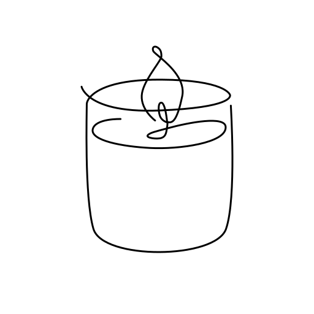

<h1>
   
   <span>CandleShop Project Documentation</span>
</h1>

> [!IMPORTANT]
**Reviva Ateliê** adopts principles of minimization and transparency in the processing of personal data, in accordance with the **General Data Protection Law (LGPD)** - Law No. **13.709/2018**.

- **Collected Data**: In contact forms, only data strictly necessary for responding to the user are requested, in addition to the data essential for order processing and delivery.

- **Purpose**: The data is used exclusively for customer service, shipping calculation, payment processing, product delivery, and compliance with legal and tax obligations.

- **Sharing with Operators**: When necessary for service execution, data is shared only with operators essential to the operation such as messaging services, payment gateways, and logistics platforms, observing applicable security standards.

- **Rights of the Data Subject**: The user may request, at any time through the brand's official contact channels, confirmation of the processing, access, correction, or deletion of their personal data, except in cases of mandatory legal retention.

## Rights of Use

All source code, visual identity, logo, product photographs, descriptions, and graphic materials displayed on the platform are the property of **Reviva Ateliê | Velas & Aromas** or used under **license / authorization from their respective holders.

Reproduction, distribution, modification, or commercial use of any visual or textual content of the store is **prohibited** without prior and express authorization.

Access to and navigation of the site are intended exclusively for personal and legitimate use to consult and purchase products, and abusive automated use, malicious reverse engineering, or any attempt to compromise the availability and security of the application are prohibited.

## Overview

**CandleShop** is a web application focused on the presentation and sale of handcrafted candles. The platform offers a clean and modern user experience, highlighting the product catalog and providing direct contact and institutional channels.

> [!WARNING]
All products are separated by **category**, **collection**, **ID** and **Stock Keeping Unit (SKU)**.  The products range between candles, diffusors and home sprays. **Reviva Ateliê** is not a store. The handmade production is 100% homemade. Even without a complex warehouse system, codes like `VE-001` or `HS-002` helps to separate package, box, label or jar making it easier when check a product.

---

## Technologies Used

- **Framework**: Angular (v17+);
- **Language**: TypeScript, HTML5, SCSS;
- **Routing**: Angular Router;
- **Code Review**: Claude Code;
- **Image Edition**: Photoroom, Google Gemini;
- **Database**: JSON;
- **Deployment**: Vercel.

## How to Execute the Project

### Prerequisites

- **Node.js** (v18 or higher);
- **npm** (v9 or higher).

---

### Local Execution (Development)

1. Navigate to the project

```bash
cd CandleShop
```

2. Install dependencies:

```bash
npm install
```

3. Generate deployment packages and test before to publish

```bash
ng build
```

4. Start the development server:

```bash
ng serve
```

Access the application in the browser at `http://localhost:4200`.

### Integration

| System | Function |
|-----|----------|
| WhatsApp | Payment by our WhatsApp, credit card and Pix |
| EmailJS | Send messages |

### Credits

- Product: Reviva Ateliê | Velas & Aromas;
- Payment: **WhatsApp**;
- Message: [EmailJS](https://www.emailjs.com); `@emailjs/browser`;

---

> [!NOTE]
We ask for your name and email address to indetify your inquiry. Your information is protected and will not be sold or shared with third parties.